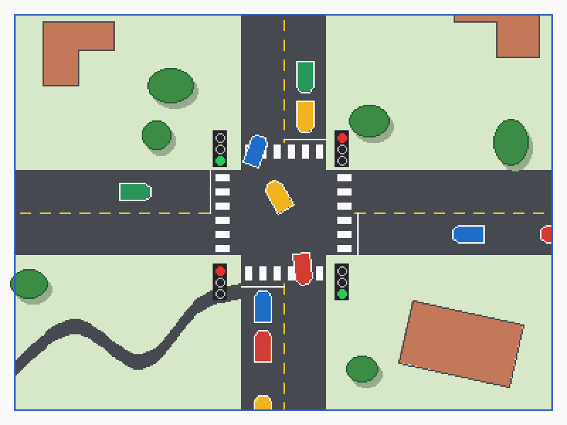
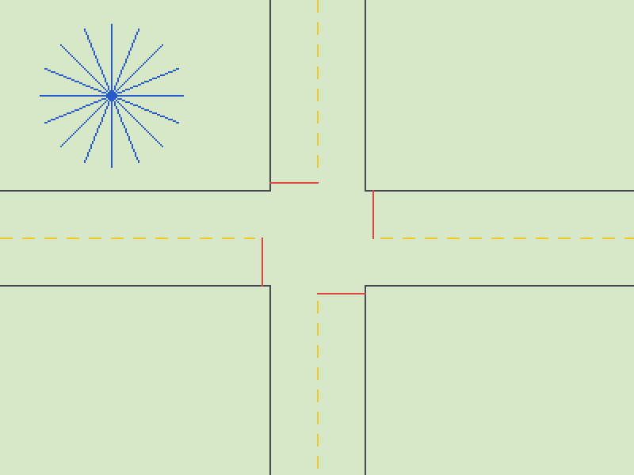
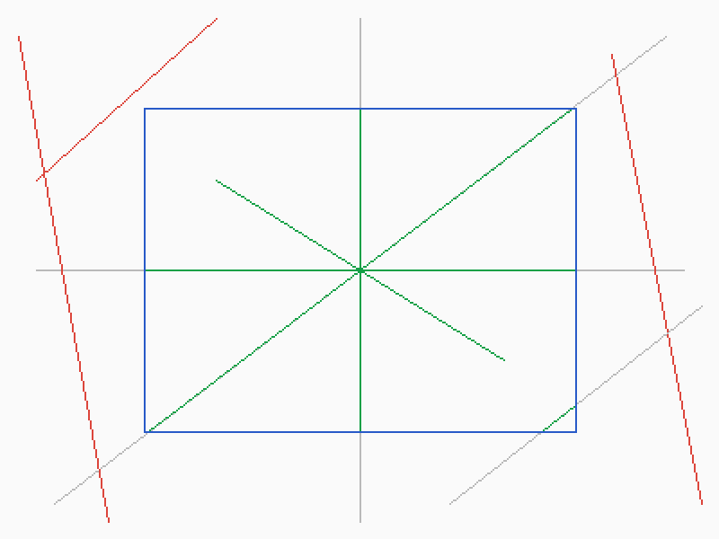
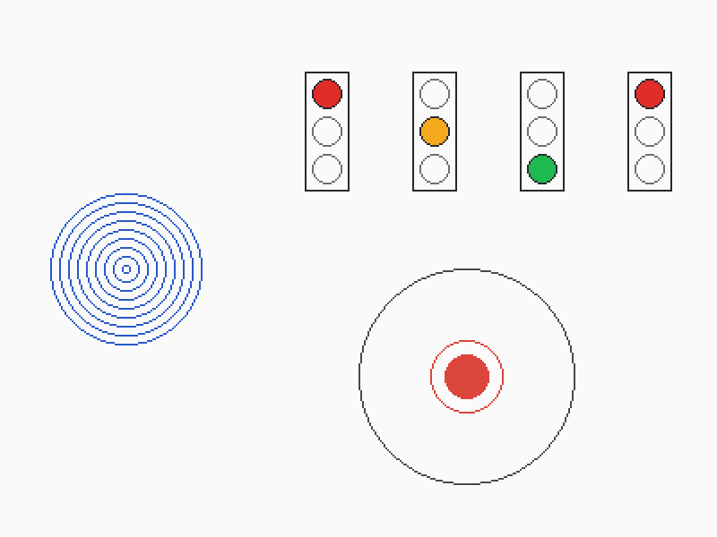
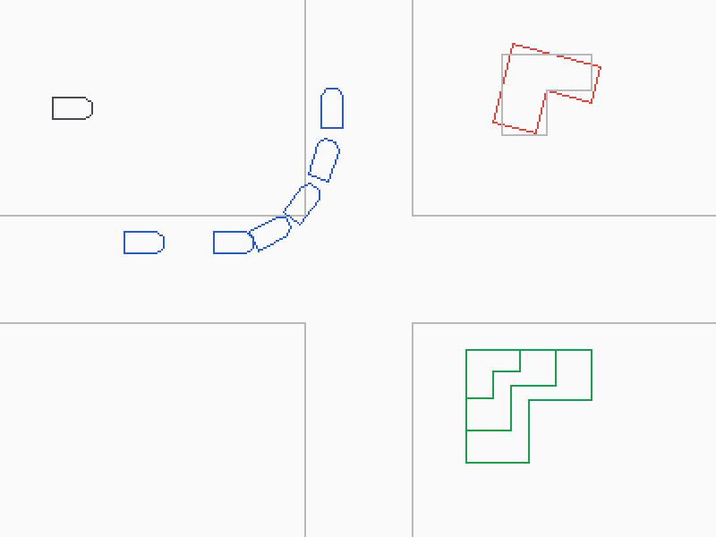
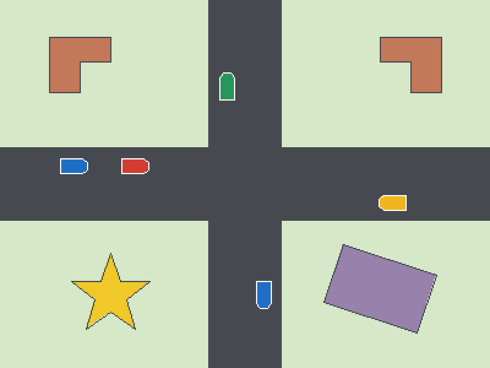
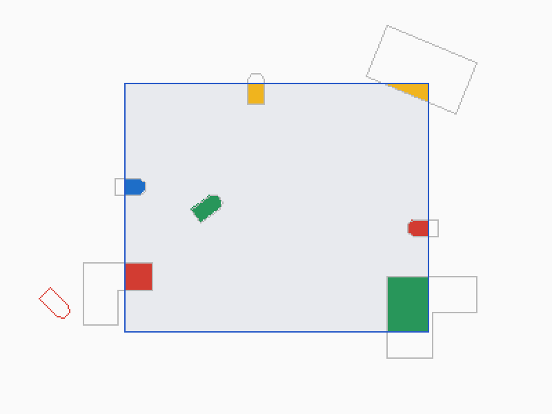
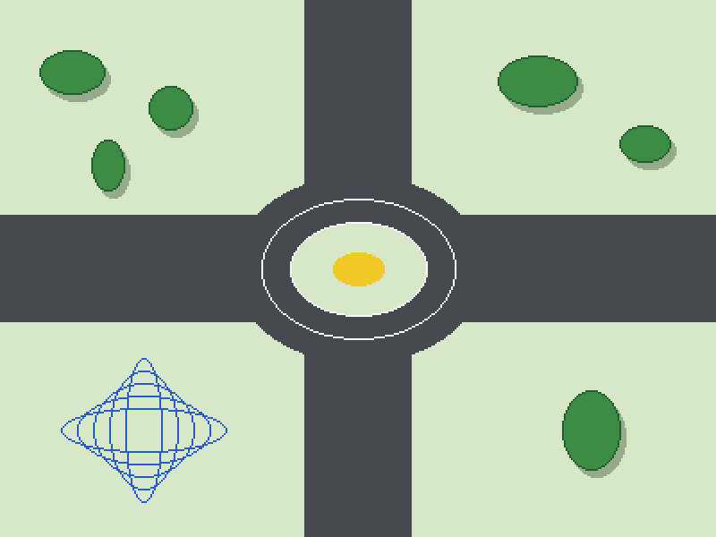
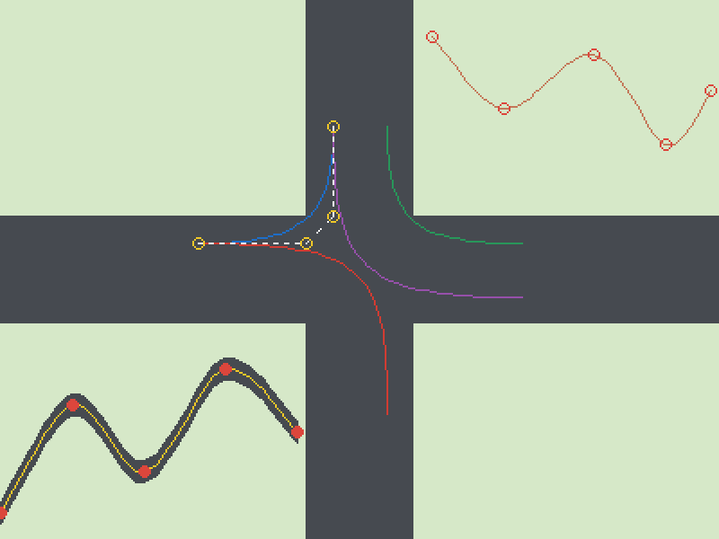

# SmartFlow - Interactive 2D Traffic Simulation

**A computer graphics group project: one road junction, drawn and animated with the graphics algorithms covered in class.**

SmartFlow is a 2D simulation of a single traffic junction. Vehicles approach from four directions, stop at traffic signals, and go straight or turn left or right. We use this familiar scene to show how computer graphics techniques draw and move objects.

**Current stage - Checkpoint 1:** the graphics algorithms covered so far are implemented in **pure C++**, with no graphics library. Each algorithm calculates exactly which pixels to colour, and our own code saves the result as an image. Every algorithm is applied to a simplified part of the junction.



## Group members and responsibilities

| Student No. | Member | GitHub | Responsibility |
| --- | --- | --- | --- |
| 165899 | Macharia Grace Wairimu | [@WMacharia](https://github.com/WMacharia) | Project concept, purpose and introduction |
| 164099 | Mwangi Billiart B. Muthoni | [@BilliartMuthoni](https://github.com/BilliartMuthoni) | Mathematics, route geometry and graphics algorithms |
| 146412 | Njugi Elijah Muiru | [@ElijahNjugi](https://github.com/ElijahNjugi) | Core C++ programming, simulation and integration |
| 168377 | Kihumba Kevin Renana | [@Kaslir](https://github.com/Kaslir) | Scene design, interface and feature scope |
| 152710 | Kisotu Samuel Lemayian | [@kisotu2](https://github.com/kisotu2) | Documentation, testing and demonstration preparation |

## Technologies and tools

- **C++17** : all algorithms and the image writer
- **g++ (MSYS2 MinGW-w64)** : compiler
- **PowerShell** : `scripts/build.ps1` compiles, tests and renders in one command
- **Git and GitHub** : version control, issues, milestone and pull requests
- **Visual Studio Code** : editor

No graphics library is used at this stage. Images are written by our own BMP writer (`src/canvas.cpp`). A graphics library (raylib) is planned for the interactive window in later milestones.

## Graphics techniques implemented so far

| Topic | Algorithm | Used in SmartFlow for | Function |
| --- | --- | --- | --- |
| Line drawing | Bresenham | Road edges, lane markings, stop lines | `bresenhamLine` |
| Line clipping | Cohen–Sutherland | Vehicle paths clipped to the junction viewport | `clipLine` |
| Circles | Midpoint circle | Traffic-light lamps | `midpointCircle` |
| Polygons | Translate, rotate, scale, shoelace area | Car bodies and buildings | `translate`, `rotate`, `scale`, `signedArea` |
| Polygon filling | Scan-line (even–odd rule) | Roads, buildings, cars | `scanlineFill` |
| Polygon clipping | Sutherland–Hodgman | Cars and buildings at the viewport edge | `clipPolygon` |
| Ellipses | Midpoint ellipse | Tree canopies, roundabout | `midpointEllipse` |
| Curves | Cubic Bézier, Catmull–Rom spline | Vehicle turning routes, side road | `cubicBezier`, `catmullRomSpline` |

### Rendered output

| | |
| --- | --- |
|  **Bresenham lines** — junction road markings |  **Cohen–Sutherland** — paths clipped to the viewport |
|  **Midpoint circle** — traffic-light lamps |  **Polygon transformations** — a car turning, buildings scaled |
|  **Scan-line fill** — roads, buildings, cars |  **Sutherland–Hodgman** — shapes clipped at the viewport |
|  **Midpoint ellipse** — roundabout and trees |  **Bézier and Catmull–Rom** — routes and side road |

## How to compile and run

**Requirements:** Windows with an x64 MinGW-w64 `g++` compiler supporting C++17 (for example MSYS2 at `C:\msys64\ucrt64\bin`).

1. Clone the repository:

   ```powershell
   git clone https://github.com/BilliartMuthoni/smartflow-cpp-interactive-2D-traffic-simulation.git
   cd smartflow-cpp-interactive-2D-traffic-simulation
   ```

2. Build, test and render:

   ```powershell
   powershell -NoProfile -ExecutionPolicy Bypass -File scripts/build.ps1
   ```

   The script compiles the code, runs every test, then writes nine images to the `output/` folder. If a test fails, the build stops.

   To use a compiler in another location:

   ```powershell
   powershell -NoProfile -ExecutionPolicy Bypass -File scripts/build.ps1 -Compiler "C:/path/to/g++.exe"
   ```

3. View the images:

   ```powershell
   start output
   ```

## Project structure

| File or folder | Purpose |
| --- | --- |
| `include/graphics.hpp` | Declarations of all algorithms and shape types |
| `src/graphics.cpp` | The algorithms — decide which pixels to colour |
| `include/canvas.hpp`, `src/canvas.cpp` | Pixel grid that stores colours and saves a `.bmp` file |
| `src/render.cpp` | Builds the junction scenes and saves the images |
| `tests/graphics_test.cpp` | Automated tests for every algorithm |
| `scripts/build.ps1` | Compiles, runs the tests and renders the images |
| `docs/` | Checkpoint report and images |
| `output/`, `build/` | Generated files; not stored in Git |

## Current progress

- All eight topics covered so far are implemented in pure C++: line drawing, line clipping, circles, polygon representation, polygon filling, polygon clipping, ellipses, and Bézier curves and splines.
- Every algorithm has automated tests (8 test groups), and all pass.
- Each algorithm is applied to a part of the junction, and a combined scene shows them working together.
- Work is tracked with GitHub issues under the **Checkpoint 1** milestone and merged through a reviewed pull request.
- The checkpoint report with screenshots is in [`docs/`](docs/).

**Next milestones:** animate vehicles along the routes, add traffic-signal timing, and build the interactive window and controls.

## Known limitations

- The output is still images, not an animation or interactive window.
- The build script is for Windows and needs a MinGW-w64 `g++` compiler.
- Images are saved as BMP files, which are larger than PNG.
- Lines are one pixel wide, with no anti-aliasing (edge smoothing).
- Polygon clipping works against rectangular windows only.
- The scene is a simplified model of one junction, not based on real traffic data.
